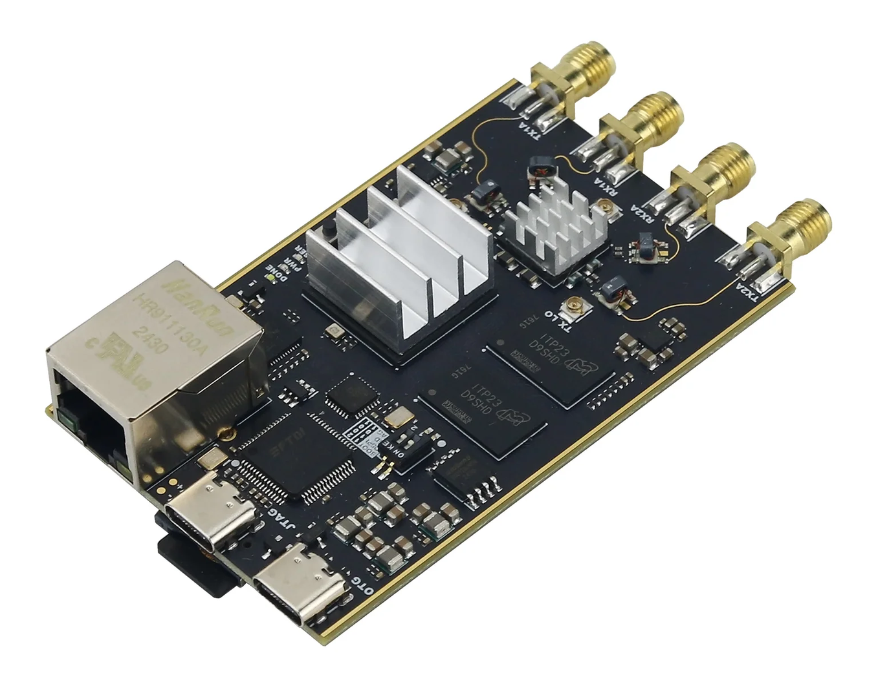

# SATCOM 4 PLUTO — satcom4pluto

<p align="center"></p>

**Continuous monitoring of the 240–270 MHz UHF satellite band with a PlutoSDR (clone).**
The Pluto's FPGA splits the whole 30 MHz band into 8192 channels. A detector on the Pluto's
ARM processor finds the downlinks, even weak 5–7 kHz FM carriers about 1–2 dB above the noise
floor and ~40 kHz wide FM. Only those downlinks travel over USB. On the PC they are rebuilt into
a normal wideband IQ stream for **OpenWebRX** (Linux) or **SDRangel** (Windows).

- Whole band at once: 36.864 MS/s, 240.6–269.4 MHz, no scanning.
- Sends only what matters: detected downlinks are real IQ. Undetected parts of the band are
  shown as noise shaped like the measured spectrum, so the waterfall shows all activity.
- Jammer filter (`--max-snr-db`), always-on ranges (`--pass`), known birdies (`--spur`).
- Unattended operation: the Pluto keeps its stock firmware and satcom4pluto is loaded into its RAM
  at every power-up. The software recovers by itself after the Pluto is unplugged or
  power-cycled.

> **Hardware note.** The FPGA design is built for a common **Pluto clone**: Zynq
> **XC7Z010-1CLG400**, AD9363 on an **LVDS** interface (run in AD9364 mode), "PlutoSDR"
> firmware v0.38. It does **not** run on an original ADALM-Pluto, which has a different FPGA
> package and a CMOS radio interface. Porting means adapting `src/fpga/vivado/system_top.v`,
> the pin constraints and the block design (see "Building from source").

---

## Contents

1. [How it works](#how-it-works)
2. [Repository layout](#repository-layout)
3. [Requirements](#requirements)
4. [Use with OpenWebRX on Linux](#use-with-openwebrx-on-linux)
5. [Use with SDRangel on Windows](#use-with-sdrangel-on-windows)
6. [Detector options](#detector-options)
7. [Troubleshooting](#troubleshooting)
8. [Technical description](#technical-description)
9. [Building from source](#building-from-source)
10. [Test results and status](#test-results-and-status)
11. [License](#license)

---

## How it works

```
          Pluto (clone)                                   PC
 ┌──────────────────────────────────┐        ┌──────────────────────────────────────────┐
 │ AD9363 ─► FPGA: 8192-bin FFT     │  USB   │ Linux: OpenWebRX + satcom4pluto device type    │
 │          channelizer (WOLA)      │ (net)  │   (SoapySDR module libsatcom4plutoSupport.so)  │
 │            │  power spectrum     │ ─────► │ Windows: sgch_rx.exe ─► SDRangel          │
 │            ▼                     │ only   │                                          │
 │ ARM: sgchd detector + tracker ──►│ the    │ rebuilds 36.864 MS/s IQ: detected bins    │
 │      chooses which bins to send  │ down-  │ = real signal, the rest = shaped noise    │
 └──────────────────────────────────┘ links  └──────────────────────────────────────────┘
```

Nothing is written to the Pluto's flash. After each Pluto power-up, the PC side copies the
satcom4pluto FPGA image (`sgch_pl.bin`) and the detector (`sgchd`) into the Pluto's RAM over ssh,
loads the FPGA image with Linux's `fpga_manager`, and starts the detector. A power cycle
returns the Pluto to its normal state.

## Repository layout

```
deploy/
  linux/      everything for a Linux PC running OpenWebRX (Docker or native), x86_64
  pc/         Windows + SDRangel (satcom4pluto.bat, sgch_rx.exe and the Pluto files)
src/
  fpga/rtl/       Verilog: channelizer (sgc_top, sgc_core, sgc_fft, sgc_afifo, sgc_axi_stub)
  fpga/vivado/    Vivado project scripts, block design, top level, constraints
  fpga/sim/       testbenches and the Python/C++ checks against the numerical model
  fpga/reports/   timing and utilisation reports of the shipped bitstream
  arm/            sgchd (Pluto daemon) and det2 (detector v2), Makefile
  pc/             sgch_rx (Windows/Linux), SoapySDR module, SDRangel helpers, sgch_ctl.py
  openwebrx/      the OpenWebRX device type and the Linux service/installer scripts
  reference/      Python reference: FPGA model, detectors, test scenarios, simulated Pluto
tools/            bit2bin.py (bitstream -> fpga_manager .bin), pluto_tryload.sh
docs/RESULTS.md   detailed test results
img/              pictures for this README
```

## Requirements

- A Pluto clone as described in the hardware note above, connected by USB. Its network
  address is set in the Pluto's `config.txt`; the examples use **192.168.5.5**, while a stock
  Pluto uses 192.168.2.1. Root password: `analog` (stock).
- **Linux / OpenWebRX:** an x86_64 PC with OpenWebRX or OpenWebRX+ (Docker image or native
  package, SoapySDR 0.8). OpenWebRX processes the full 36.864 MS/s, so use a reasonably strong
  PC, not a Raspberry Pi. You also need the ssh client: OpenSSH 8.4 or newer (Debian 11 /
  Ubuntu 22.04 and later), or the `sshpass` package.
- **Windows / SDRangel:** Windows 10/11 (OpenSSH client built in), SDRangel 7.x.

---

## Use with SDRangel on Windows

1. Plug in the Pluto and check that `ping 192.168.5.5` answers. The Pluto address and all
   other settings are at the top of `deploy\pc\satcom4pluto.bat`.
2. Run **`deploy\pc\satcom4pluto.bat`**. It:
   - waits for the Pluto;
   - if the Pluto was just powered up, loads satcom4pluto into it. Type the password **`analog`**
     when asked (twice);
   - configures the radio and serves the stream for SDRangel on port 1234.

   Keep its window open; you can minimise it. After a settings change, close it and start
   it again.
3. Start **SDRangel** yourself and set up the receiver once:
   1. In the main window, add a receiving device set (the **Rx** button, or *Devices → Add Rx
      device*) and choose **RemoteTCPInput** from the device list.
   2. In the device panel:
      - **IP** `127.0.0.1`
      - **Port** `1234`
      - **Protocol** **SDRangel** (not RTL0)
      - **Dec** 1
   3. Press ▶ (start). The status line shows "Device: USRP | Protocol: SDRA", and the spectrum
      shows 255 MHz and 36.864 MS/s (240.6–269.4 MHz). The radio controls are greyed out on
      purpose, so SDRangel cannot push other settings to the Pluto.
   4. Add an **NFM Demodulator** channel (*Add channel* in the device set) and move it onto a
      downlink. Use an RF bandwidth of about 12.5 kHz for 5–7 kHz downlinks, or 40–50 kHz for
      wide ones.
   5. For a readable spectrum, set averaging in the spectrum toolbar (e.g. moving average
      10–20) and a range of about 70 dB.

   SDRangel remembers this setup when you close it normally, so next time only step 3.3
   (press ▶) is needed. If satcom4pluto.bat was restarted, press ■ then ▶ to reconnect.

> SDRangel's **RTL0** (rtl_tcp) mode is limited to 3.2 MS/s by SDRangel and cannot show the
> 30 MHz band. Always use protocol **SDRangel**.

---

## Use with OpenWebRX on Linux

### 1. Install (once)

1. Plug in the Pluto and check that `ping 192.168.5.5` answers. If your Pluto uses another
   address, edit `PLUTO=` in `deploy/linux/satcom4pluto.conf` before installing.
2. Copy the `deploy/linux` folder to the PC and run, inside it:

   ```
   sudo sh install_linux.sh
   ```

   That is the only command. It:
   - installs the service `satcom4pluto`, which loads satcom4pluto into the Pluto's RAM after
     every Pluto power-up (checked every 10 s);
   - finds the running OpenWebRX container, adds the **satcom4pluto** device type to it (SoapySDR
     module, device type, feature registration) and restarts it.

   If the container has an unusual name, run `sudo sh install_linux.sh NAME`. If OpenWebRX
   is installed without Docker, use `sudo sh install_linux.sh --native`.

### 2. Add the device in OpenWebRX (once)

In the OpenWebRX web page, go to Settings → SDR devices and profiles → Add new device:

| field | value |
|---|---|
| Device type | **satcom4pluto (Pluto satellite-downlink channelizer)** |
| Pluto address | `192.168.5.5` |
| Detector options | `-f 240:270 --max-snr-db 40 --kernel sin3` |
| Device gain | `30` (fixed gain, not "auto") |

Then add a profile:

| field | value |
|---|---|
| Center frequency | `255000000` |
| Sample rate | `36864000` |
| Initial frequency | e.g. `250000000` |
| Initial modulation | NFM |

Save. The waterfall shows 240.6–269.4 MHz.

### 3. Daily use

Switch everything on and open OpenWebRX in a browser. Nothing else is needed.

- **Change the detector** (band, jammer limit, `--pass` ranges…) in the device's "Detector
  options". It applies immediately; see [Detector options](#detector-options).
- **Pluto unplugged or power-cycled:** the waterfall goes blank, then within about 20 s the
  Pluto is reloaded and all settings are restored.
- **OpenWebRX container re-created** (e.g. image update): the service puts the satcom4pluto files
  back within 5 minutes.
- **Logs:** `journalctl -u satcom4pluto -f` for the loader, `docker logs <container>` for
  OpenWebRX (lines starting with `satcom4pluto:`).
- **Uninstall:** run `sudo sh uninstall_linux.sh`, remove the device in OpenWebRX, and
  power-cycle the Pluto.

---

## Detector options

These go into OpenWebRX's "Detector options" field or `DETECTOR=` in `satcom4pluto.bat`.
Separate them with spaces and do not use commas (except inside `--widths`).
Detection is always on. Every option is optional; anything not given uses the default.
An unknown or out-of-range option is refused with an error and the previous settings stay active
(OpenWebRX logs it, `satcom4pluto.bat` shows it).

Recommended: `-f 240:270 --max-snr-db 40 --kernel sin3`

**What is searched and sent**

| option | default | limits | meaning |
|---|---|---|---|
| `-f LO:HI` | whole received band | repeat, max 32 | range in MHz in which downlinks are searched and sent |
| `--pass LO:HI` | none | repeat, max 16 | **always send** this range (MHz) as real IQ, detected or not. Use it for blocks of channels spaced closer than the detector can resolve (e.g. a 5 kHz channel raster). Jammers blocked by `--max-snr-db` stay blocked inside it |
| `--max-snr-db DB` | off | any dB | **jammer filter**: a signal peaking more than DB above the local noise floor is not sent; it is released again when it falls 3 dB below the limit |
| `--spur MHZ` | none | repeat, **max 32** | ignore a known birdie / internal spur at this frequency, e.g. `--spur 250.0 --spur 262.144` |
| `--max-bw-khz K` | 150 | 5 … 2000 | widest single detection. Larger keeps a wide block as one signal; smaller stops neighbours merging in a crowded band |
| `--dc-notch-khz K` | 5 | ≥ 0 (0 = off) | ignore detections within K kHz of the centre frequency (LO leakage of the AD9363) |
| `--max-rate MSPS` | 6.5 | > 0, **max ≈ 6.8** | USB budget in MS/s. When more is detected, the weakest detections are dropped first; `--pass` ranges are always kept. Measured limit of the Pluto's USB network link: about 6.8 MS/s (27 MB/s, the Pluto CPU is then busy with network interrupts). Above that, samples are lost **without** any error counter showing it, so do not set it higher. The full busy 240–270 MHz band would need about 13 |
| `--kernel K` | `sin3` | `sin1`, `sin3`, `sin5` | FPGA detection smoothing: `sin1` sharpest, `sin5` least leakage from strong signals |

**Sensitivity and tracking** (the thresholds are statistical, in standard deviations of the
local noise, so they work the same at any gain or noise level)

| option | default | limits | meaning |
|---|---|---|---|
| `--z-det Z` | 5.5 | > 0 | threshold for a new signal on the fast spectrum. Lower = weaker signals and more false detections |
| `--z-slow Z` | 6.0 | > 0 | threshold for a new signal on the slow, averaged spectrum (finds very weak steady carriers) |
| `--z-keep Z` | 3.0 | > 0 | a signal already found is kept while it stays above this |
| `--confirm M/N` | 2/3 | 1 ≤ M ≤ N ≤ 16 | a new signal is sent after M hits in N updates (one update ≈ 0.1 s) |
| `--hold-s S` | 2 | ≥ 0 | keep sending S seconds after a signal disappears (bridges fades and short pauses) |
| `--widths K,K,…` | 5,7,12.5,25,40,60 | max 8 values, kHz | the signal widths searched for |
| `--stream-candidates` | off | flag | send signals before they are confirmed: faster, but more noise is sent too |

**How much is sent around each signal**

| option | default | limits | meaning |
|---|---|---|---|
| `--guard-khz K` | 4.5 | ≥ 0 | extra margin each side |
| `--bw-factor F` | 1.25 | > 0 | sent width = detected width × F + 2 guards |
| `--narrow-extract-khz K` | 12.5 | ≥ 0 | minimum sent width for narrow signals |

**Diagnostics** (not for normal use)

| option | meaning |
|---|---|
| `--all` | no detection: send the `-f` ranges completely (minus `--max-snr-db` signals); limited by `--max-rate` |
| `--default` | send nothing and return the Pluto's receive path to normal samples; cannot be combined with other options |

`sgchd --help` on the Pluto prints the same list.

---

## Troubleshooting

| symptom | cause / fix |
|---|---|
| Waterfall blank, OpenWebRX log shows `satcom4pluto: cannot connect` | Pluto not reachable: check `ping`, the USB cable, `PLUTO=` in `/etc/satcom4pluto.conf`, and `journalctl -u satcom4pluto` |
| `Bus error` when running `sgchd` by hand | The satcom4pluto FPGA image is not loaded (stock image). Let the loader / `satcom4pluto.bat` load it. |
| Some channels look smeared (flat blocks) | Those parts are noise fill: nothing was detected there, or the USB budget dropped them. Use `--pass` for known channel blocks. |
| A strong carrier at exactly 250.000 MHz | Probably a clock harmonic of the board itself. Check with the antenna removed; if so, add `--spur 250.0`. |
| Band edges (240 / 270 MHz) a bit lower | Measured −2.2 dB roll-off of the AD9363 at ±15 MHz (see below). |
| SDRangel shows 3.2 MS/s | Wrong protocol: use **SDRangel**, not RTL0. |

---

## Technical description

### Signal chain in the FPGA

The Pluto's stock HDL (Analog Devices `hdl`, `projects/pluto`) is plumbing. `axi_ad9361`
receives the LVDS samples from the AD9363, `rx_fir_decimator` optionally decimates,
`util_cpack2` packs the samples, and `axi_dmac` writes them to DDR for the ARM.

satcom4pluto inserts one module, **`sgc_top`**, between `rx_fir_decimator` and `util_cpack2`:

- **Mode 0** (default): samples pass unchanged, so the Pluto behaves like a stock Pluto.
- **Mode 1**: the DMA carries channelizer frames instead of samples.

The module is controlled over AXI4-Lite at **0x43C00000**.

```
 l_clk domain (DATA_CLK/4 = fs)              core domain (FCLK0, 100 MHz)
 ─────────────────────────────              ─────────────────────────────────────────────────
 I/Q 12 bit ─► sgc_afifo ─────────────────► ring buffer (2N) ─► sqrt-Hann window ─► FFT N=8192
                (async FIFO, gray pointers)                                       │
                                                                ┌─────────────────┴───────────────┐
                                                                ▼                                 ▼
                                                  detection kernel across bins       selected runs of bins
                                                  |X|² >> PSH, sum over 2^AVG        × per-bin gain / 2^OSH
                                                  frames → spectrum (double bank)     → "SGCH" frames
                                                                │                                 │
 ◄──── util_cpack2 / axi_dmac ◄── sgc_afifo ◄────────────────────┼─────────────────────────────────┘
                                                                ▼
                                                 ARM reads the spectrum (AXI 0x8000)
```

**1. Analysis filter bank (WOLA).**
- Every N/2 = 4096 input samples (hop, 50 % overlap) the core takes the last N = 8192 samples
  from a 2N-sample ring buffer and applies a **square-root Hann** window, w[n] = sin(πn/N).
- It computes an 8192-point FFT. At 36.864 MS/s that is one FFT every 111 µs, with
  **4.5 kHz bins**.
- With the same window used for synthesis and overlap-add on the PC, this is a
  *perfect-reconstruction* filter bank **for any subset of bins**. That is what lets the PC
  rebuild clean IQ from only the bins it receives. Bin *b* is at f_LO + (b < N/2 ? b : b − N)·fs/N.

**2. FFT core (`sgc_fft.v`).**
- A streaming radix-2 decimation-in-time FFT. Input arrives in bit-reversed order (read that
  way from the ring buffer), output comes in natural bin order.
- Each stage uses a 3-multiplier (Gauss) complex multiply, which needs 3 DSP48 slices, and a
  quarter-wave twiddle ROM. Twiddles are 18-bit Q16. The first stage needs no multiplier.
- Per-stage scaling (grow / halve / saturate) keeps the data path at a fixed width.
- Every register advances only on an enable signal, so the pipeline can stall without losing
  data.

**3. Detection spectrum.**
- For every bin the core applies a short kernel **across neighbouring bins**:

  | kernel | coefficients | equivalent window |
  |---|---|---|
  | sin⁵ | [1 −4 6 −4 1]/16 | sin⁵ |
  | **sin³** | [−1 2 −1]/4 | sin³ |
  | sin¹ | [1] | sin¹ |

  Convolving in frequency is the same as multiplying the time window by sin²ⁿ, so one FFT
  gives both the reconstructable sqrt-Hann channels and a lower-leakage detection spectrum.
- It then computes |·|² » PSH and sums 2^AVG frames into a **double-banked** spectrum
  memory (8192 words at AXI 0x8000). The ARM reads one bank while the other accumulates.
- Kernel selection is new in v1.1 (`PARAM[25:24]`).

**4. Bin selection and output frames.**
- The ARM writes a **run list** (start, length) and an **8-bit gain per bin** into shadow
  memories (0x6000, 0x4000) and swaps them in atomically.
- For every hop, the core outputs one frame:

  ```
  H0 = 0x53474348 "SGCH"
  H1 = frame sequence number k     (covers input samples kN/2 … kN/2+N−1)
  H2 = {osh[3:0], L[3:0], flags[7:0], nruns[15:0]}
  per run: {len[15:0], start[15:0]}, then len words {Q[15:0], I[15:0]} = X[b]·gain/256 / 2^osh
  ```

- The frames go through `util_cpack2` / `axi_dmac` to the ARM. The ARM forwards them over
  TCP port 30471, which avoids iiod's request/response gaps.

**5. Clock domains and load.**
- The sample side runs on the radio interface clock: DATA_CLK = 4·fs = 147.5 MHz at
  36.864 MS/s. The core runs at 100 MHz.
- Gray-code asynchronous FIFOs (`sgc_afifo.v`) cross in both directions, with 2-flip-flop
  synchronisers for status.
- One hop needs ≈ 8192 + header cycles out of 100 MHz × 4096 / 36.864 MHz ≈ 11 111 cycles,
  so the core is about **74 % busy** at 36.864 MS/s.

**6. Other changes from the stock Pluto design.**
- TX FIR interpolator, TX DDS and TX IQ correction removed, to free logic and DSP slices.
  TX still works at AD9361 rates (≥ 2.08 MS/s).
- The PL I2C controller at 0x41600000 is replaced by a stub (`sgc_axi_stub.v`): the clone
  has no pins for it, but the device tree probes it.
- LVDS pin-out and constraints for the XC7Z010-CLG400 clone (`system_top.v`,
  `system_constr.xdc`).

**Resources (XC7Z010, shipped build).**

| resource | whole design | satcom4pluto core only |
|---|---|---|
| LUT | 11 125 (63 %) | 6 184 |
| BRAM | 42.5 / 60 | 38 RAMB36 + 5 RAMB18 |
| DSP | 73 / 80 | 39 |

**Timing (shipped build).** WNS +0.624 ns, WHS +0.016 ns with the radio clock constrained to
125 MHz (`src/fpga/reports/`).

### Register map (`src/fpga/rtl/sgc_top.v`)

| offset | access | register |
|---|---|---|
| 0x0000 | R | ID `0x53474348` ("SGCH") |
| 0x0004 | R | VERSION {major, minor} = 1.1 |
| 0x0008 | R | CONFIG {L, RUNS_L, IN_W} |
| 0x000C | R | CORE_HZ |
| 0x0010 | RW | CTRL: [0] run, [1] DMA carries frames, [2] emit, [31] soft reset |
| 0x0014 | RW | PARAM: [3:0] AVG, [11:8] PSH, [19:16] OSH, [25:24] kernel (0 sin⁵, 1 sin³, 2 sin¹) |
| 0x0018 | R | STATUS: [0] spectrum ready, [1] swap pending, [2] active bank |
| 0x001C | RW | SPEC: R spectra completed, W release |
| 0x0020–0x0040 | R | FRAMES, DROPS, SAT, WORDS, BANK, NRUNS, SAMPLES, IN_OVF, RATE |
| 0x4000 | W | gains: 4 bins per word, 255 = unity |
| 0x6000 | W | runs: {len[15:0], start[15:0]} |
| 0x8000 | R | power spectrum, bin b at 0x8000 + 4b |

### Detector on the ARM (`src/arm/det2.c`, reference `src/reference/satref/det_v2.py`)

Per update, i.e. one FPGA spectrum of 2^AVG frames (28–114 ms):

1. **Local noise floor.**
   - Take the 30th percentile of every 32-bin segment (hop 16), skipping bins of known signals
     and spurs, with a bias correction for the averaging.
   - Clip each segment against its neighbours, so strong signals cannot raise the floor.
   - Interpolate in dB and smooth over time.

   This follows the slope and ripple of the AD9363 response across the band.
2. **Normalised spectrum.** R = P / floor (noise ≈ 1), plus a slow average of R (≈ 0.7 s)
   for the weakest signals.
3. **Multi-resolution, statistically calibrated detection.**
   - Windows of 5, 7, 12.5, 25, 40 and 60 kHz average R.
   - The threshold for each width is measured from the data's own spread (MAD over
     signal-free positions), not set in dB.
   - A window triggers at z ≥ 5.5 (fast) or 6 (slow).

   After averaging hundreds of FFTs, a 1 dB rise in one bin is about 6σ, which is why signals
   about 1–2 dB above the floor are found.
4. **Segmentation.** Greedy CLEAN with extents taken from the slow spectrum, valley splitting,
   rejection of tails and skirts, spur and DC pre-claiming, and narrow-in-wide detection by
   spectral asymmetry.
5. **Tracking.**
   - A detection is a CANDIDATE until it appears in 2 of 3 updates (or z ≥ 15), then becomes
     CONFIRMED / ACTIVE.
   - It goes to HOLD for 2 s after it disappears, then EXPIRED.
   - Centre and bandwidth are smoothed over time.
6. **Allocation.**
   - Each streaming track gets an extraction interval: bandwidth × 1.25 plus a 4.5 kHz guard
     band on each side (at least 12.5 kHz for narrow signals).
   - Then `--pass` ranges are added and `--max-snr-db` blocks are cleared.
   - The result is limited to `--max-rate`, dropping the weakest first.
   - The gains and runs are written to the FPGA.

`sgchd` also controls the AD9363 RX interface delay (register 0x006 = 0x06, centred in the
measured eye). It serves a text control protocol on TCP 30470 (`STATUS`, `TRACKS`, `SET`,
`GET`, `SUBSCRIBE`, `MODE`) and the raw frame stream on TCP 30471.

### PC side (`src/pc`)

- **Synthesis.**
  - For every frame, the received bins go into an 8192-point inverse FFT, are multiplied by
    the sqrt-Hann window, and overlap-added with hop 4096. The output is the original
    36.864 MS/s IQ, exact for the received bins.
  - Missing bins are filled with complex Gaussian noise scaled to the FPGA's measured power
    spectrum (pushed by `sgchd`), so the waterfall stays complete.
  - FFTs use the bundled pocketfft; no libiio or FFTW is needed.
- **SoapySDR module `satcom4pluto`** (`soapy_satcom4pluto.cpp` → `libsatcom4plutoSupport.so`) for OpenWebRX:
  - CF32/CS16 stream; the analog bandwidth follows the sample rate automatically.
  - Detector options are a Soapy setting (`sgchd`), applied live.
  - **Self-healing**: it opens without a Pluto, reconnects, and re-applies LO, rate, gain,
    bandwidth and detector options after a Pluto reset. While there is no data it sends zeros
    in real time, so OpenWebRX never writes the device off.
- **OpenWebRX device type** (`src/openwebrx/satcom4pluto.py`), plus a small FeatureDetector
  registration appended to `owrx/feature.py` (OpenWebRX checks features before importing
  device modules).
- **sgch_rx.exe** (Windows):
  - Serves SDRangel's Remote TCP protocol (SDRA) with the radio settings locked.
  - Has an optional per-downlink mode: `--channels`, one 72 kS/s stream per track.
  - Its watchdog exits when the Pluto disappears, and `satcom4pluto.bat` restarts it.

### Measured on the hardware

**Instantaneous bandwidth** (LO sweep of a fixed carrier, FIR off):

| fs / analog bandwidth | response at ±15 MHz (240 / 270 MHz) |
|---|---|
| 30.72 MS/s / 30 MHz | −8.9 dB |
| 30.72 MS/s / 56 MHz | −6.2 dB |
| **36 MS/s / 40 MHz** | **−2.2 dB**; aliases from ≥ 21 MHz offset ≤ −18 dB |

Hence the default of 36.864 MS/s with a 40 MHz analog bandwidth. The rate was chosen so the
bins are exactly 4.5 kHz.

**Live on the band (36.864 MS/s):** 0 dropped frames, 0 FIFO overflows, about 250 tracks in
the busy real band. The detector takes 50–70 ms per update on the ARM; averaging is lengthened
automatically when it falls behind.

**USB output limit** (2026-10-12, this Pluto clone, Windows PC, 36.864 MS/s, 10–25 s per step):
the whole band was split into 32 small ranges with `--all` so the output always fills `--max-rate`,
and a PC client read the stream as fast as it could.

| `--max-rate` | sent by the Pluto | received by the PC | lost |
|---|---|---|---|
| 5.0 | 4.98 MS/s | 4.99 MS/s | none |
| 6.3 | 6.22 MS/s | 6.22 MS/s | none (25 s) |
| 6.9 | 6.75 MS/s | 6.73 MS/s | ≈ none (within measurement error) |
| 7.2 | 7.01 MS/s | 6.75 MS/s | ~4 % |
| 8.0 | 7.46 MS/s | 6.69 MS/s | ~10 % |

The ceiling is about 6.8 MS/s (27 MB/s). It is the same with a second reader program, and the
Pluto then has one CPU core fully busy with network interrupts, so the limit is the Pluto's USB
network link, not the PC. The FPGA's `drops` / `inovf` counters stay at 0 when this happens, so
the loss is not reported. Default `--max-rate` is 6.5 (0.3 below the ceiling).

---

## Building from source

### FPGA (Vivado 2026.1)

1. Clone the Analog Devices HDL repository at branch `hdl_2026_r1` and build the required IP
   libraries. `src/fpga/vivado/win_build.tcl` writes Windows batch files for both steps.
2. Build the project:

   ```
   vivado -mode batch -source src/fpga/vivado/system_project.tcl -tclargs <adi-hdl-dir> <repo>/src/fpga
   ```

3. Convert the bitstream for `fpga_manager`:

   ```
   python3 tools/bit2bin.py system_top.bit sgch_pl.bin
   ```

   It is the bitstream payload with each 32-bit word byte-swapped.
4. Simulation: `src/fpga/sim` has testbenches for Icarus Verilog and Vivado xsim. `run_top.py`
   compares the core bit for bit with the Python model (`src/reference/satref/fpga_model.py`)
   for all three kernels.

> The source contains one change not yet in the shipped bitstream: an extra pipeline register
> in the detection path (sgc_core stage "A2", verified in simulation), and the radio clock
> constraint tightened to 160 MHz (`system_constr.xdc`, 6.25 ns) for 36.864 MS/s.
>
> The shipped `sgch_pl.bin` is the earlier v1.1 build, which met timing with a 125 MHz
> constraint. It has run correctly on the hardware at 147.5 MHz, but that rate is outside
> what its timing analysis covered. A full rebuild with the tighter constraint has not been
> completed yet.

### Pluto daemon

```
cd src/arm && make          # needs arm-linux-gnueabihf-gcc; static binary, runs on the stock firmware
```

### PC software

- **Windows:** `src/pc/build_win.sh` (mingw-w64) builds `sgch_rx.exe`.
- **Linux:** `cmake` in `src/pc` builds `sgch_rx`, plus the SoapySDR module if SoapySDR is
  installed.
- **OpenWebRX module:** build it against **SoapySDR 0.8.1** on a system with glibc ≤ 2.35, so
  it also loads in Debian bookworm/trixie containers (the shipped one was built on
  Ubuntu 22.04).

### Reference and tests (`src/reference`)

- Python models of the FPGA and both detectors, a synthetic scenario suite (weak FM, adjacent
  and overlapping, narrow-in-wide, fading, variable floor, spurs), Pd / false-alarm sweeps,
  audio-SNR comparisons, a C-vs-Python comparison (`cmp_c.py`), and a simulated Pluto
  (`fake_pluto.py`) for testing the PC and OpenWebRX side without hardware.
- Needs numpy and scipy.

---

## Test results and status

Details are in [docs/RESULTS.md](docs/RESULTS.md).

**Detection (simulation, both detectors):**
- The new detector finds 5 and 7 kHz FM about 1 dB above the floor in over 99 % of trials;
  the earlier detector needed about 4 dB.
- No false tracks on flat or rippled noise in 300 s of simulation; the earlier detector
  opened 48 % of the band on rippled noise.
- Centre-frequency error is about 50–300 Hz, against 0.5–8 kHz before.
- Limit: two 5 kHz channels 10 kHz apart merge, because of the 4.5 kHz bins. Use `--pass`
  for such blocks.

**Real recording with injected test signals:** narrow FM reliably detected from about 2 dB
above the floor.

**Audio:** narrowband downlinks rebuilt from the selected bins match an ideal
down-converter; wideband ones are within 1–4 dB, at audio SNRs above 30 dB.

**C port:** identical to the Python reference on all 11 scenarios.

**Hardware** (bitstream in RAM, sgchd, SDRangel through `sgch_rx`): full 30 MHz at
36.864 MS/s with no lost frames.

**OpenWebRX:** verified against a simulated Pluto with the current OpenWebRX+ code,
`soapy_connector` and SoapySDR 0.8.1, including:
- the device type;
- correct spectrum and NFM audio;
- a live switch to the 36.864 MS/s profile;
- recovery after the Pluto disappears and comes back with reset settings;
- an idempotent installer.

**Not yet verified:**
- the Linux package with a real Pluto and a real Docker container;
- the CPU load of OpenWebRX at 36.864 MS/s on the target PC;
- a timing-closed rebuild of the FPGA with the 160 MHz constraint.

---

## License

**MIT**, see [LICENSE](LICENSE), for everything in this repository except:

- `src/fpga/vivado/system_bd.tcl`, `system_project.tcl`, `system_top.v` and
  `system_constr.xdc`, which are derived from the
  [Analog Devices HDL](https://github.com/analogdevicesinc/hdl) Pluto project and fall under
  its license terms. The bitstream (`sgch_pl.bin`) contains Analog Devices IP cores.
- `src/pc/pocketfft_hdronly.h`: pocketfft, BSD-3-Clause (`src/pc/POCKETFFT_LICENSE.md`).

OpenWebRX, SoapySDR and SDRangel are separate projects under their own licenses. The
installer only adds files to an existing OpenWebRX installation.
